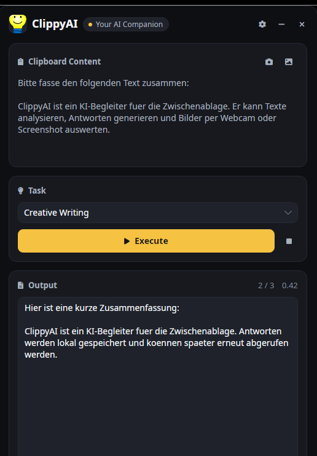

**ClippyAI**
================

**Overview**

ClippyAI is an innovative tool which enables you to use local AI more efficiently for your daily tasks. It takes the content from your clipboard and sends them along with a task to a local AI provider.
After being processed, the response will be available in the clipboard and can be pasted into any application.

**Features**

* **Highest Level of Data Privacy**: Your data stays your data and nothing leaves your PC. After installation, you can
even use this tool completely offline.
* **Ollama and OpenAI Integration**: Choose between local Ollama or cloud-based OpenAI API for AI processing, providing flexibility based on your privacy and performance needs.
* **Clipboard Integration**: ClippyAI seamlessly integrates with your system's clipboard, capturing text instantly
after it is copied or cut. The clipboard's content can then be sent along with a task to the Ollama or OpenAI API. After execution, the output will be available in the clipboard for pasting into any application.
* **Super Fast Response Times**: Generated outputs can be saved as templates in an embedded [LanceDB](https://lancedb.com/) vector database that ships inside ClippyAI — no database server to install. Embeddings are created with the selected AI provider (Ollama or OpenAI), so ClippyAI can quickly find the best matching template for your input. If no suitable template answer for your task is found, the output is generated by the LLM in the classical way.
* **Desktop Notifications**: System notifications inform the user about the task status.
* **Cross-Platform Support**: Developed with .NET and Avalonia, ClippyAI runs on Windows and Linux (X11), ensuring that users can enjoy its benefits regardless of their platform. Hotkeys allow the user to use ClippyAI easily, without interacting with the user interface.
* **SSH Tunneling Support**: Securely connect to remote Ollama/OpenAI instances through SSH tunnels, enabling access to AI services and data storage over encrypted connections.

**Example Use Cases**

* Copy an email and let ClippyAI write the response
* Copy some code from an IDE and let ClippyAI find an error
* Explain a complicated text to understand it better
* Translate a text into another language
* Summarize a long text in a few sentences
* Do OCR image analysis of a document captured by a webcam



**Getting Started**

1. Install Ollama from [https://ollama.com/download](https://ollama.com/download).
2. Download the latest release of ClippyAI for your OS (Windows or Linux).
3. Run the Windows `.msi` installer or install the `.deb`/`.rpm` packages on Linux/X11 systems.
4. Run `ClippyAI` from the start menu of your OS and click on the tray icon to open it.
5. Click on the `Pull` button in the `Options` section and enter `gemma4` to let ClippyAI download and install the Google Gemma4 AI model to your local PC. Please be patient, as the downloading can take a few minutes, depending on how fast your internet connection is.
6. Uncheck `Use Embeddings`, if you want to use the application without caching via an embedding vector database, otherwise follow the instructions in the next section.

**Alternative: Using OpenAI API**

If you prefer cloud-based AI processing or want to use vLLM:
1. Obtain an OpenAI API key from [https://platform.openai.com/](https://platform.openai.com/).
2. Open ClippyAI and go to `Options` → `General Settings`.
3. Select "OpenAI" from the AI Provider dropdown.
4. Enter your OpenAI API key in the provided field.
5. Optionally, customize the model and vision model.
6. Save the configuration. Note that cloud OpenAI usage may incur costs based on your API plan.

**Setting Up the Embedding Cache (optional)**
1. Open `Options` → `Embeddings` and enable `Use Embeddings`.
2. Embeddings use the AI provider selected on the `General` tab:
   - **Ollama**: pull an embedding model, e.g. click `Pull` and enter `nomic-embed-text`.
   - **OpenAI**: enter your API key on the `General` tab; the default model is `text-embedding-3-small`.
3. Adjust the embedding model for each provider in the `Embeddings` tab.
4. Answers are stored locally in an embedded LanceDB database under the ClippyAI app-data folder
   (`~/.config/ClippyAI/lancedb` on Linux, `%APPDATA%\ClippyAI\lancedb` on Windows). Set a custom
   folder in the `Embeddings` tab if you prefer.

No PostgreSQL, pgai extension, Docker container, or `OLLAMA_HOST=0.0.0.0` configuration is needed anymore.

**Setting Up SSH Tunneling (optional)**

For secure remote connections to Ollama/OpenAI instances:
1. Configure SSH tunnel settings in ClippyAI's configuration dialog under the SSH tab.
2. Enter your remote host details (hostname, port, username).
3. Specify the local and remote ports for tunneling (e.g., local port 11434 to remote Ollama port 11434).
4. Provide SSH private key file or password for authentication.
5. Start the tunnel to enable secure access to remote AI services or databases.

**Using ClippyAI**

1. Choose a task from the dropdown list. For image analysis, select an image task (tasks with "Image Analysis Task" enabled).
2. For text tasks: Copy or cut some text from an application (e.g., email, chat, or document) via [Ctrl]+[C].
   For image tasks: Either copy an image to the clipboard (for "Clipboard" source tasks) or ensure your webcam is connected (for "Webcam" source tasks).
3. Click `Send` or use the keyboard shortcut [Ctrl]+[Alt]+[C] to execute the selected task.
4. Review or paste ([Ctrl]+[V]) your generated result in the application where you need it.

**Request Limits**

Every model request is bounded so a slow or runaway model cannot lock up the app:

- **Max Length** (per task, in the Tasks tab) is capped at **8192 tokens**.
- Clipboard input is truncated at **24,000 characters** before it is sent.
- A request is aborted after **600 seconds**; the app reports a timeout instead of staying in the "Please wait" state forever.

The input and timeout limits can be changed in the configuration database
(`~/.config/ClippyAI/clippyai_config.db`, table `Configuration`) and take effect on the next request:

| Key | Default | Allowed range |
|-----|---------|---------------|
| `RequestTimeoutSeconds` | 600 | 15–3600 |
| `MaxInputCharacters` | 24000 | 1000–128000 |

**Image Analysis Tasks**

Image analysis is now integrated into the task system. You can create dedicated image analysis tasks in the Configuration dialog under the **Tasks** tab:

- Enable "Image Analysis Task" checkbox for a task to make it an image analysis task.
- Set "Image Source" to **Clipboard** (use an image from clipboard) or **Webcam** (capture from webcam).
- Configure the model and system prompt (vision prompt) for each image task independently.

Default image tasks "Analyze Clipboard Image" and "Analyze Webcam Image" are provided out of the box.

**Keyboard Shortcuts**

ClippyAI provides convenient global hotkeys that work even when the window is hidden or minimized:

| Hotkey | Action |
|--------|--------|
| **Ctrl + Alt + C** | Send clipboard content with selected task to the LLM |
| **Ctrl + Alt + Up** | Select previous task in the task list |
| **Ctrl + Alt + Down** | Select next task in the task list |

All hotkeys trigger notifications to display the current status or selected task, providing visual feedback even when the main window is hidden.

**Linux hotkey permissions**

On Linux, ClippyAI reads key events directly from `/dev/input/event*`, which is owned by `root:input`.
The user must be allowed to read those devices:

```bash
sudo usermod -aG input $USER
```

Log out and back in afterwards, then select the keyboard under `Options` → `System` → `Configure Hotkey Device`.
The dialog lists every keyboard it can read and switches the running monitor immediately.

**Disclaimer**

This tool is in an early development phase. Use it at your own risk. We take no responsibility, if it accidently deletes or overwrites your currently opened documents or if your LLM creates faulty or dangerous content.

If you encounter any issues or having questions or new ideas about using ClippyAI, please open an issue here on GitHub.

**Future Plans**

Go to the issues page on this Github repo to see things I've planned for the future.

**Developers Wanted!**

ClippyAI is an open-source project that relies on contributions from passionate developers like you. If you're interested in joining the ClippyAI community and contributing to its development, here are some ways you can get
involved:

* **Bug Fixing**: Help me squash those pesky bugs that prevent users from enjoying the full potential of ClippyAI.
* **Feature Development**: There are several things in my mind on how to improve ClippyAI. Take a look at the issues page for open enhancements. You may also suggest new features or enhancements.
* **Testing**: Put ClippyAI through its paces and help me to identify areas where it can be improved.

To get started with contributing to ClippyAI, please submit your pull requests.

**Licensing & Terms**

ClippyAI is distributed under the terms of the [MIT License](/LICENSE.md). By using ClippyAI, you agree to abide by
the terms and conditions outlined in the license.
